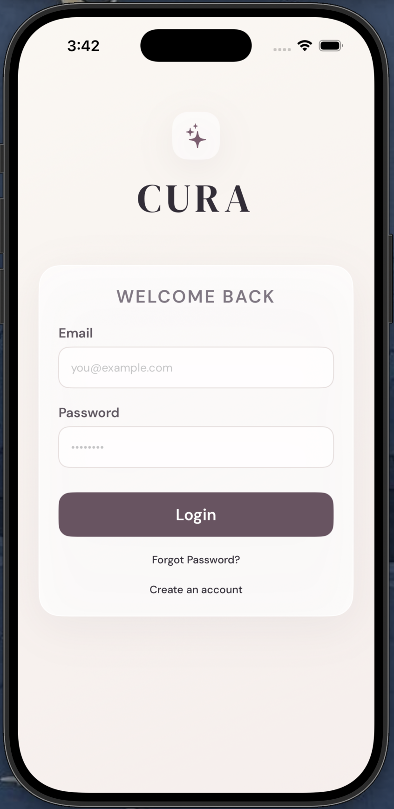
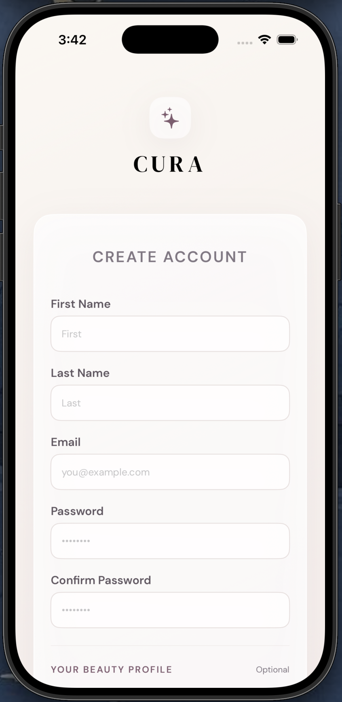
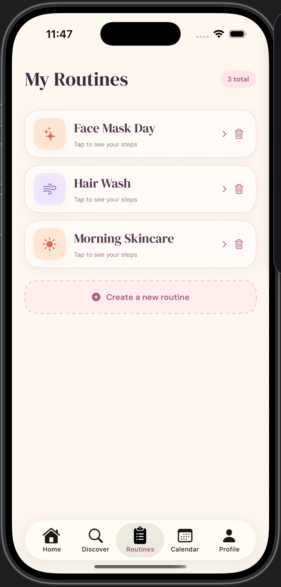
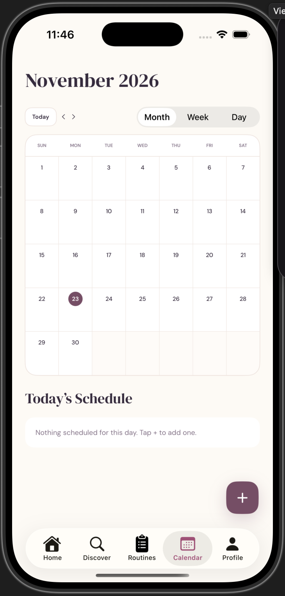
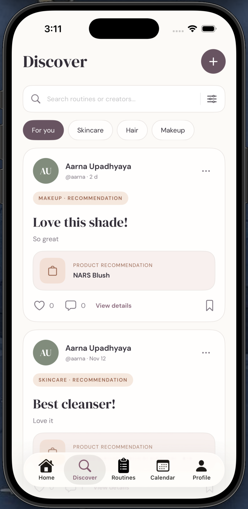
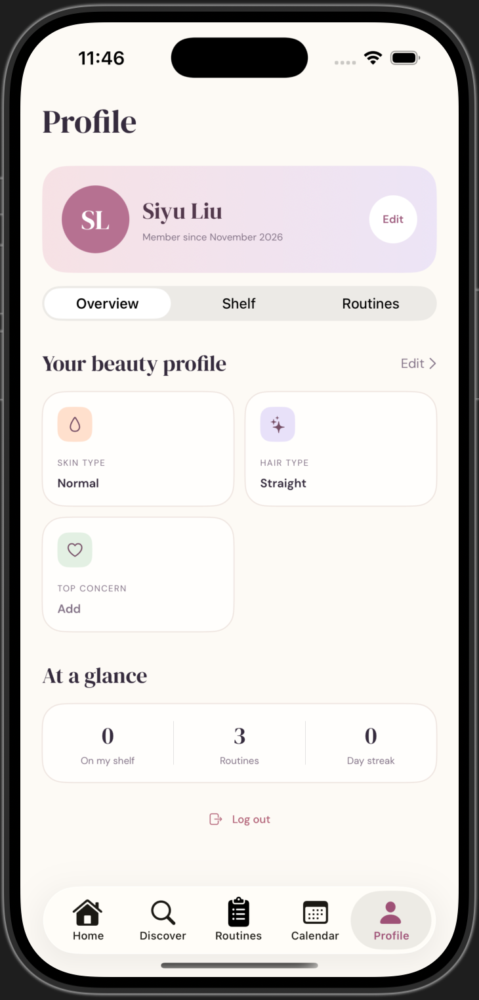

# CURA 

*A personal beauty and self-care planner built with SwiftUI and Supabase.*

CURA is an iOS application designed to help users organize their beauty routines, track cosmetic products, and manage appointments and reminders in one place. With a clean and personalized interface, CURA makes it easier to stay consistent with self-care habits.

## The Problem

Managing beauty and self-care routines can become disorganized. Users may rely on separate apps for tracking products, scheduling appointments, setting reminders, and keeping track of their daily routines.

CURA addresses this problem by bringing these features together into a single application, making it easier for users to organize their self-care activities without switching between multiple tools.

## Features

### Personalized Profile
- Create an account and securely log in.
- Personalize your profile with information such as skin type, hair type, and beauty concerns.
- Update personal information and manage account settings.
- Maintain a digital shelf of beauty products.

### Beauty Routines
- Create and manage personalized self-care routines.
- Add, edit, and delete individual routine steps.
- Organize routines based on individual needs.
- View routines and their steps from the home screen.

### Calendar & Reminders
- Schedule beauty appointments and self-care activities.
- View schedules in monthly, weekly, and daily calendar layouts.
- Create recurring reminders for routines and appointments.
- Receive local notifications for scheduled activities.
- View upcoming appointments and today's reminders from the home screen.

### Discover Community
- Explore routines and product recommendations shared by other users.
- Share personal routines and beauty recommendations.
- Search and filter community posts by category.
- Like, bookmark, and comment on posts.

### Home Dashboard
- View today's routines, reminders, and appointments in one place.
- Quickly access routine steps.
- Keep track of daily self-care activities.

## Tech Stack

| Technology | Purpose |
|---|---|
| Swift | Primary programming language |
| SwiftUI | Native iOS user interface |
| Supabase | Backend services and cloud database |
| Supabase Auth | User authentication and session management |
| PostgreSQL | Relational data storage through Supabase |
| Supabase Storage | Storage for product images |
| UserDefaults | Local persistence for routine reminders |
| UserNotifications | Scheduling local notifications |
| Xcode | Development and testing |

## Implementation

### Architecture

CURA follows an MVVM-style architecture (Model-View-ViewModel), separating the user interface, application logic, and data access.

The codebase is organized into several main components:

- **Models:** Define the application's data structures, including users, routines, routine steps, appointments, products, and community posts.
- **Views:** SwiftUI screens responsible for displaying information and handling user interaction.
- **ViewModels:** Manage screen state, user actions, loading indicators, and communication with services.
- **Services:** Handle authentication, database operations, file uploads, and notification scheduling.
- **Shared Components:** Reusable interface elements, colors, fonts, and styling used throughout the application.

This structure helps keep the code organized, reduces duplication, and makes individual features easier to maintain.

### Backend & Database

CURA uses **Supabase** as its backend, with PostgreSQL for storing application data.

The database manages information such as user profiles, beauty products, routines, routine steps, appointments, and community content.

Separate service classes handle CRUD (Create, Read, Update, Delete) operations and communicate with Supabase using its Swift SDK.

Records associated with individual users are linked through their authenticated user IDs, allowing the app to retrieve the appropriate data for each account.

The app uses a primarily **network-first approach**, with Supabase serving as the source of truth for cloud-backed data. Routine reminders are stored locally using UserDefaults, allowing them to persist across app launches.

### Authentication

Authentication is implemented using **Supabase Auth**.

Users can create accounts, log in, log out, and change or reset their passwords. The app checks for an existing valid session when it launches to determine whether to display the authentication screens or the main application.

Using Supabase Auth eliminates the need to implement and maintain a custom authentication backend.

### Notifications & Scheduling

CURA uses Apple's **UserNotifications** framework to schedule local notifications for appointments and routine reminders.

The calendar supports recurring activities and provides different views for organizing upcoming events.

### UI Design

CURA was designed with a soft, minimal aesthetic to make daily self-care planning feel approachable and organized.

The interface uses custom colors, typography, reusable SwiftUI components, and consistent card-based layouts throughout the app.

## Screenshots

*Screenshots will be added below.*

### Authentication

<p align="center">
  
  
</p>

### Main Features

<p align="center">
  
  
  
</p>

<p align="center">
  
  
</p>

## Demo Video

*A walkthrough demonstrating CURA's main features will be added here.*

[Watch the CURA Demo](Docs/Videos/demo.mp4)

## Getting Started

### Requirements

- macOS with Xcode installed
- An iOS simulator or compatible iOS device
- A configured Supabase project

### Setup

1. Clone the repository:

   ```bash
   git clone https://github.com/sliu382/Group1-iOS-Apprenticeship.git
   ```

2. Open `Cosmetic-Planning-App.xcodeproj` in Xcode.
3. Allow Xcode to resolve the project's Swift Package dependencies.
4. Configure the Supabase connection using `Secrets.example.xcconfig` as a reference. The app expects `SUPABASE_URL` and `SUPABASE_PUBLISHABLE_KEY` to be available through its configuration.
5. Set up the Supabase database by running the files in `supabase/` in the SQL Editor, in this order:
   1. `profiles.sql`, then `profiles_add_beauty_fields.sql`
   2. `routines.sql`, then `routine_steps.sql`
   3. `appointments.sql` (already includes the columns from the two `appointments_add_*.sql` files, which are only needed for older databases)
   4. `products.sql` (also creates the `product-images` storage bucket)
   5. `discover_posts.sql` (depends on profiles, routines and routine steps)
6. Select an iOS simulator or connected device and run the application.

**Note:** The repository does not include a fully automated Supabase setup. A compatible backend must be configured for cloud-backed features to function.

## Project Structure

```text
Cosmetic-Planning-App/
├── App/
│   ├── RootView.swift
│   ├── MainTabView.swift
│   └── AppState.swift
├── core/
│   ├── models/
│   └── services/
├── features/
│   ├── Auth/
│   ├── Home/
│   ├── Discover/
│   ├── Routines/
│   ├── Calendar/
│   └── Profile/
├── Shared/
│   └── components/
└── Resources/
    ├── Assets.xcassets/
    └── Fonts/
```

## Project Background

CURA was developed as part of an iOS development apprenticeship project, with a focus on building a functional application using modern iOS development practices.

The project provided hands-on experience with SwiftUI, authentication, relational databases, backend integration, persistence, reusable components, and application architecture.

The goal was to create a cohesive application that combines a polished user experience with practical features for everyday beauty and self-care planning.
